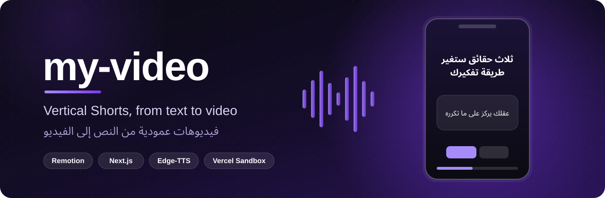
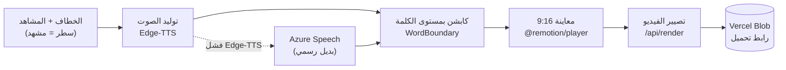

<div align="center">



<br/>

[](https://github.com/MOT1209/my-video/actions/workflows/ci.yml)
[](https://github.com/MOT1209/my-video/actions/workflows/codeql.yml)


**[الموقع الحي](https://my-video-kappa-one.vercel.app)** ·
**[سير العمل](#سير-العمل)** ·
**[البدء السريع](#البدء-السريع)** ·
**[المتغيرات](#متغيرات-البيئة)** ·
**[البنية](#البنية)**

</div>

---

## نبذة

تطبيق يحوّل نصاً قصيراً إلى فيديو **Shorts عمودي 9:16** (1080×1920 بسرعة 30fps): خطاف في أول ثانيتين، ثم مشاهد، مع **تعليق صوتي** وكابشن يتحرك **كلمة بكلمة**. المعاينة فورية في المتصفح عبر `@remotion/player`، والتصيير النهائي يجري على **Vercel Sandbox** ويُرفع إلى **Vercel Blob** مع رابط تحميل.

> [!NOTE]
> المشروع مبني على قالب [Remotion on Vercel](https://remotion.dev/docs/vercel-sandbox)، ويضيف إليه محرر Shorts عربياً، وتوليد الصوت والسكربت والخلفيات، وطبقة حسابات وكريدت (SaaS).

## سير العمل



1. **اكتب** الخطاف (حتى 120 حرفاً) والمشاهد (حتى 12 مشهداً، 280 حرفاً للمشهد). يمكنك أيضاً لصق رابط مقال أو موضوع ليقترح Gemini سكربتاً.
2. **اختر** الثيم والصوت وأسلوب حركة الكابشن.
3. **ولّد الصوت**: يُنتج mp3 مع توقيت كل كلمة ويُحفظ في الكاش.
4. **عاين** الفيديو. المدة تُحسب من آخر كلمة + ثانية أمان، بسقف **60 ثانية** (حد يوتيوب Shorts).
5. **صيّر** الفيديو واحصل على رابط التحميل.

## المزايا

| | الميزة | التفاصيل |
|---|---|---|
| 🎙️ | **تعليق صوتي** | Edge-TTS مجاني (عربي: زارية وحامد، إنجليزي: Ava وAndrew)، وAzure Speech بديلاً رسمياً عند الفشل |
| 💬 | **كابشن كلمة بكلمة** | 4 أنماط حركة: `pop` و`karaoke` و`slide-up` و`glow` |
| 🎨 | **5 ثيمات** | `dark` و`paper` و`neon` و`news` و`quotes` |
| 🤖 | **سكربت بالذكاء الاصطناعي** | من رابط أو موضوع عبر Gemini (يحتاج `GEMINI_API_KEY`) |
| 🖼️ | **خلفيات AI** | عبر Gemini مع كاش بمفتاح المحتوى (يحتاج `GEMINI_API_KEY`) |
| 🎧 | **تفريغ صوت** | تحويل ملف صوتي إلى نص عبر Gemini |
| ⚡ | **كاش التصيير** | الناتج الحتمي نفسه لا يُصيَّر مرتين، مع قياس تكلفة الفيديو |
| 🔐 | **حسابات وكريدت** | Clerk وNeon وStripe (اختيارية، انظر [المتغيرات](#متغيرات-البيئة)) |
| 🛡️ | **حدود استخدام** | لكل IP عبر Upstash Redis مع بديل في الذاكرة محلياً |

## البدء السريع

المتطلبات: **Node 22** و**Bun** (لتشغيل الاختبارات).

```bash
git clone https://github.com/MOT1209/my-video.git
cd my-video
npm ci

# اسحب المتغيرات من Vercel (أو أنشئ .env.local من .env.example)
vercel login && vercel link
vercel env pull .env.local

npm run dev            # http://localhost:3000
```

> [!TIP]
> بدون أي مفتاح يعمل المحرر والمعاينة وتوليد الصوت محلياً. التصيير يحتاج `BLOB_READ_WRITE_TOKEN`.

## الأوامر

| الأمر | الوظيفة |
|---|---|
| `npm run dev` | خادم التطوير |
| `npm run build` | بناء الإنتاج (Next.js) |
| `npm test` | الاختبارات عبر `bun test` على `src/` (93 اختباراً في 16 ملفاً وقت كتابة هذا الملف) |
| `npm run lint` | فحص ESLint للتطبيق |
| `npx remotion studio` | استوديو Remotion |
| `npm run cleanup-blobs` | عرض الملفات الأقدم من 30 يوماً في Blob (تجريبي، لا يحذف) |
| `npm run cleanup-blobs -- --delete --older-than-days=7` | حذف فعلي |

## متغيرات البيئة

تُضبط في Vercel ← Settings ← Environment Variables. غياب أي متغير اختياري **يعطّل ميزته فقط** برسالة إرشادية.

| المتغير | مطلوب؟ | ما الذي يتعطل بدونه |
|---|---|---|
| `BLOB_READ_WRITE_TOKEN` | **نعم** للتصيير | التصيير ورفع الصوت والخلفيات (الصوت المحلي يعمل) |
| `GEMINI_API_KEY` (+ `GEMINI_MODEL`, `GEMINI_IMAGE_MODEL`) | اختياري | اقتراح السكربت والخلفيات وتفريغ الصوت |
| `NEXT_PUBLIC_CLERK_PUBLISHABLE_KEY`, `CLERK_SECRET_KEY` | **موصى به بشدة** | تسجيل الدخول، ويبقى `/api/render` **مفتوحاً لأي زائر** (خطر تكلفة في الإنتاج) |
| `DATABASE_URL` (Neon) | اختياري | المشاريع والكريدت وسجل التصييرات (تعطي 503 برسالة واضحة) |
| `STRIPE_SECRET_KEY`, `STRIPE_WEBHOOK_SECRET` | اختياري | شراء حزم الكريدت |
| `CRON_SECRET` | اختياري | إعادة محاولة التصييرات الفاشلة (`/api/cron/retry-renders`) |
| `UPSTASH_REDIS_REST_URL`, `UPSTASH_REDIS_REST_TOKEN` | اختياري | حد المعدل والقفل الموزّعان (يعمل بديل الذاكرة محلياً) |
| `AZURE_SPEECH_KEY`, `AZURE_SPEECH_REGION` | اختياري | البديل الرسمي للصوت (يبقى Edge-TTS المجاني) |

بعد ضبط `DATABASE_URL` طبّق الهجرة مرة واحدة: `npx drizzle-kit migrate`.

## حدود الاستخدام

| المسار | الحد | عند التجاوز |
|---|---|---|
| `/api/tts` | **20 طلباً / 5 دقائق** لكل IP | 429 مع رسالة عربية و`Retry-After` |
| `/api/render` | **5 عمليات / ساعة** لكل IP | 429 (التصيير مكلف: دقائق من Sandbox) |

## البنية

<details>
<summary><b>الفيديو والتصيير</b></summary>

<br/>

| المسار | الدور |
|---|---|
| `src/remotion/Shorts/` | تكوين الفيديو: خلفية وعنوان وبطاقات وكابشن |
| `src/components/ShortsEditor.tsx` | المحرر والمعاينة والتصيير |
| `src/app/api/render/` | التصيير عبر Sandbox ورفع Blob (SSE للتقدم) |
| `src/lib/render-cache.ts` | كاش ناتج التصيير بمفتاح حتمي |
| `src/lib/render-metrics.ts` | قياس تكلفة الفيديو |
| `types/shorts.ts` | الأنواع والقواعد (60 ثانية، 12 مشهداً) |

</details>

<details>
<summary><b>الصوت والذكاء الاصطناعي</b></summary>

<br/>

| المسار | الدور |
|---|---|
| `src/app/api/tts/` | توليد الصوت والكاش (مفتاح `voiceId::text`) |
| `src/lib/edge-tts.ts` | عميل Edge TTS (WebSocket وحدود الكلمات) |
| `src/lib/sec-ms-gec.ts` | توكن Sec-MS-GEC v2، منقول من المكتبة الرسمية ومغطى باختبارات |
| `src/lib/azure-tts.ts` | البديل الرسمي للصوت |
| `src/app/api/script/` | رابط أو موضوع ← سكربت عبر Gemini |
| `src/app/api/image/` | خلفيات AI وكاش المحتوى |
| `src/app/api/transcribe/` | تفريغ صوت مرفوع إلى نص |
| `src/lib/rate-limit.ts` | حد المعدل (Upstash مع بديل محلي) |

النص الكامل (الخطاف + المشاهد) محدود بـ 1000 حرف (`MAX_TTS_CHARS` في `src/lib/tts.ts`).

</details>

<details>
<summary><b>الحسابات والكريدت (SaaS)</b></summary>

<br/>

| المسار | الدور |
|---|---|
| `src/app/api/projects/` و`[id]` | حفظ وتحميل وحذف مشاريع المستخدم |
| `src/app/api/renders/` | سجل التصييرات وإعادة التنزيل |
| `src/app/api/credits/` | الرصيد الحالي |
| `src/app/api/billing/checkout` | جلسة Stripe لشراء حزمة |
| `src/app/api/billing/webhook` | أحداث Stripe بعد التحقق من التوقيع |
| `src/app/api/cron/retry-renders` | إعادة التصييرات الفاشلة (يحميه `CRON_SECRET`) |
| `src/app/sign-in/` | تسجيل الدخول عبر Clerk |

**نموذج الكريدت** (`src/lib/credits.ts`): كل تصيير = 1 كريدت، و3 مجاناً عند التسجيل، والحزم: 10 بـ $5 و30 بـ $12 و100 بـ $35. يُخصم الكريدت بعد التأكد من غياب الكاش، ويُرجَع إن فشل التصيير.

</details>

<details>
<summary><b>مشروع <code>King_Browser/</code> داخل المستودع</b></summary>

<br/>

مجلد `King_Browser/` مشروع **منفصل** (متصفح سطح مكتب مبني بـ Electron) يعيش في المستودع نفسه، وله `package.json` واختباراته وإعداد ESLint الخاص به. لا علاقة له بتطبيق الفيديو، وهو مستثنى من فحص `lint` و`tsc` للجذر.

```bash
cd King_Browser
npm ci
npm test                         # اختباراته الخاصة (esbuild + Node)
../node_modules/.bin/eslint .    # فحص ESLint بإعداده الخاص
```

</details>

## النشر على Vercel

1. من لوحة Vercel: **Storage ← Create ← Blob**، بإعداد **public** (الفيديوهات والصوتيات تُخدم بروابط عامة)، واربطه بالمشروع. يُضاف `BLOB_READ_WRITE_TOKEN` تلقائياً.
2. أضف بقية [المتغيرات](#متغيرات-البيئة) التي تحتاجها ثم أعد النشر.
3. للـ Cron: `vercel.json` يعرّف مهمة يومية على `/api/cron/retry-renders`، وتحتاج `CRON_SECRET`.

> [!WARNING]
> **قبل الإنتاج:** فعّل [Vercel Spend Management](https://vercel.com/docs/accounts/spend-management)، وأضف مفاتيح **Clerk** (وإلا بقي التصيير مفتوحاً للجميع)، ونظّف الـ snapshots والفيديوهات القديمة دورياً بـ `npm run cleanup-blobs -- --delete`.

## توثيق إضافي

- [`report.html`](report.html): تقرير المراجعة والتطوير الكامل (يُفتح في المتصفح).
- [`plan.md`](plan.md): خارطة الطريق التنفيذية.
- [Remotion on Vercel](https://remotion.dev/docs/vercel-sandbox) · [Discord](https://remotion.dev/discord)

## الرخصة

كود هذا المشروع مرخّص تحت [رخصة MIT](LICENSE) (مجلد `King_Browser/` له ملف `LICENSE` خاص به). وللمساهمة انظر [CONTRIBUTING.md](CONTRIBUTING.md).

> [!IMPORTANT]
> رخصة MIT تغطي كود المشروع فقط. **Remotion** له شروطه الخاصة، ولبعض الاستخدامات يلزم ترخيص شركة. [الشروط هنا](https://github.com/remotion-dev/remotion/blob/main/LICENSE.md).
